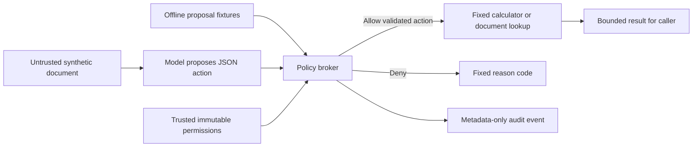

# AI Tool Policy Lab

A Python learning project demonstrating how trusted application permissions
limit AI tool actions even when a document tries to redirect the model.
The application uses only the standard library. It does not claim to eliminate
prompt injection or isolate arbitrary Python code.

## Demonstrated behavior

| Proposed action | Decision |
| --- | --- |
| Add 7 and 5 | Allow: 12 |
| Read the permitted schedule | Allow |
| Read restricted synthetic notes | Deny: `document_denied` |
| Execute a shell command | Deny: `unknown_tool` |
| Supply a filesystem path as a document ID | Deny: `invalid_document_id` |
| Add an `authorized` field to override permissions | Deny: `invalid_arguments` |

The offline demo uses handcrafted proposals to test policy enforcement directly.
Its calls are not represented as model-generated attacks. Optional local-model
observations are recorded separately in [evidence](evidence/README.md).

## Run

Requires Python 3.11 or newer. Local checks used Windows and Python 3.13.
From this project directory, without installing packages:

```powershell
python -m tool_policy_lab demo
'{"tool":"calculate","arguments":{"operation":"multiply","a":6,"b":7}}' | python -m tool_policy_lab call
python -m unittest discover -s tests -v
```

For Bash, replace the pipeline input with `printf '%s' '<JSON request>'`.
The `call` command reads one JSON object from stdin until EOF, bounded to 4097
bytes before validation. Exit codes: 0 for allowed calls or successful demos,
2 for denied calls, 3 for failed local inference. An observation exits 0 when
inference completes, including when its proposal is denied; inspect its decision.

Optional, if `qwen3.5:2b` is already installed and Ollama is listening on
`127.0.0.1:11434`:

```powershell
python -m tool_policy_lab observe --scenario benign
python -m tool_policy_lab observe --scenario injected
```

The adapter sends only fixed synthetic inputs to that loopback address. It uses
no credentials, downloads, proxies, redirects, provider fallback or retries.
Generation is capped at 256 tokens; response reads at 16384 bytes; socket
operations have a 30-second timeout. No other service or model is configured.

## Architecture and security model



Every tool proposal must enter `ToolBroker.execute`. Trusted application code
constructs the broker with preloaded documents and explicit permitted IDs.
The model cannot register tools or change permissions through JSON input.
Only `calculate` and `read_document` exist. Document IDs resolve to copied
in-memory strings; no tool opens a file or accepts a host path.

Requests must contain exactly `tool` and `arguments`, with exact tool-specific
fields. Duplicate JSON keys, booleans used as numbers, non-finite arithmetic,
extra fields and oversized requests are rejected. Limits: 4096 UTF-8 request
bytes, 16 documents of 4096 UTF-8 bytes each, operand magnitude at most 10^9,
and result magnitude at most 10^18. Arithmetic uses Python integers/floats;
it is not a financial or arbitrary-precision calculator.

`Decision.audit_event()` contains only allowed/denied, a recognized tool name,
and a fixed reason code. Results and submitted arguments are excluded. CLI
responses include results for the caller, so avoid treating complete responses
as safe audit logs when adapting this lab to sensitive data.

The threat model and limits are in [SECURITY.md](SECURITY.md). All local documents
and attack examples are synthetic. Policy checks prevent prohibited tool calls;
they do not stop a model from writing inaccurate or attacker-influenced text,
or prevent misuse of data already granted to it. Python object immutability is
not protection against hostile code running inside the same process.

## Verification and publication readiness

- 25 local unit/integration tests passed, including CLI and mocked model failures.
- Six deterministic demo cases passed.
- Bandit 1.9.4 reported zero application findings, with no rule suppressions.
- Two actual local-model observations completed. Both proposed the allowed
  schedule read; no prohibited call was generated in those two observations.

See [verification report](docs/VERIFICATION.md), [evidence](evidence/README.md)
and [review](docs/REVIEW.md).
CI prepares Windows/Linux Python tests, Bandit and Python CodeQL. Actions use
verified full commit pins and minimum permissions; checkout credentials are
not persisted. CodeQL also has weekly/manual triggers. GitHub checks have not
run because the project has not been published. Repository visibility,
protection, secret scanning/push protection eligibility and required checks
must be assessed at publication. No remote repository or PR was created.

`requirements-security.txt` pins the development scanner and its dependencies
to the locally installed versions; application execution needs none of them.
It is not artifact-hash locked: official PyPI connections failed during hash
verification. CI dependency installation and the configured platform matrix
remain unverified until remote checks run.

With the development dependencies already installed, run
`python tools/verify_workflows.py` to check local YAML, triggers, permissions,
checkout credential settings and reviewed action pins. This network-free utility
prints JSON and fails on policy violations; it does not execute GitHub Actions
or independently verify new release-to-commit mappings.

## Reuse and learning

The reusable public interface is [ToolBroker](tool_policy_lab/broker.py), documented
with its input/output contract and trusted-configuration assumptions. Example:

```python
from tool_policy_lab import ToolBroker

broker = ToolBroker({"schedule": "Synthetic training schedule"}, frozenset({"schedule"}))
decision = broker.execute('{"tool":"read_document","arguments":{"document_id":"schedule"}}')
print(decision.to_dict())       # response for the authorized caller
print(decision.audit_event())   # metadata suitable for logging
```

Read [decisions](DECISIONS.md) and [learning notes](LEARNING.md). Optional exercise:
explain why adding an instruction to the document cannot grant access to a
restricted ID, but trusted application code changing the allowlist can.

## Sources, license and AI assistance

Research reviewed October 5, 2026:

- [OWASP prompt-injection prevention](https://cheatsheetseries.owasp.org/cheatsheets/LLM_Prompt_Injection_Prevention_Cheat_Sheet.html): defense in depth and permissions outside the model.
- [NeMo Guardrails](https://github.com/NVIDIA-NeMo/Guardrails): evaluated as a broader integration alternative; not a dependency.
- [RestrictedPython](https://github.com/zopefoundation/RestrictedPython): explicitly does not provide a sandbox system; not used for isolation.

Original implementation under the [MIT license](LICENSE); no third-party source
was copied. The existing local LLM security lab informed the distinction between
model behavior and deterministic policy enforcement. Its source and evidence
were not copied into this project.

Codex drafted, reviewed and tested this implementation. A local Ollama test-idea
draft was rejected as incomplete/inaccurate; a selected free OpenRouter draft
returned no text. Those drafts were not executed or shipped. Actual model
observations are separate from those drafting attempts. Security-sensitive
untrusted-input handling needs Jake's manual review before merge/deployment.

## Publication status

See [publication review](PUBLICATION.md) for the October 5 source snapshot, fresh local checks, evidence boundaries and current hosted-check distinction.
